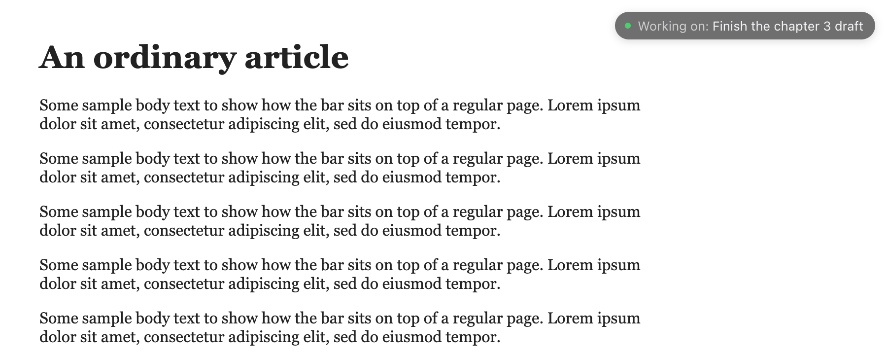

# Task Reminder (Chrome extension)

Shows a small floating bar — "Working on: *your task*" — in the corner of every regular web page, so you always remember what you sat down to do.



## Features

- One current task at a time. No lists.
- Set the task from the toolbar icon: type it and press **Start**.
- The bar stays fixed in the viewport while you scroll, and is styled to stay out of the way.
- **Drag the bar anywhere.** The position is remembered and shared across tabs. It can't be dragged off-screen, and **Reset position** in the bar's menu puts it back in the top-right corner.
- Click the bar to **Edit task**, **Complete task**, or **Collapse** it. Collapsed, it leaves a small dot you can click to expand again.
- The task, collapsed state and position are stored in `chrome.storage.local` and sync live across all tabs. They survive page reloads, new tabs and browser restarts.
- With no task, nothing is shown on pages.
- Chrome's internal pages (`chrome://` pages, the New Tab page, the Chrome Web Store) can't show the bar; manage the task from the toolbar icon there. The icon shows a small green dot while a task is active.

Everything stays on your machine: no account, no backend, no network requests.

## Install (load unpacked)

1. Open `chrome://extensions` in Chrome.
2. Turn on **Developer mode** (top-right).
3. Click **Load unpacked** and select the **`extension`** folder in this repository (`task-reminder-extension/extension`), not the repository root.
4. Click the puzzle-piece icon in the toolbar and pin **Task Reminder**.

Tabs that were already open when you install get the bar without a refresh.

Optional: to show the bar on local `file://` pages, open the extension's **Details** and enable **Allow access to file URLs**.

### Updating after code changes

Click the reload arrow on the Task Reminder card in `chrome://extensions`. There's no need to remove and re-add it.

## Usage

| Action | How |
| --- | --- |
| Start a task | Click the toolbar icon, type the task, press Enter or **Start** |
| Rename the task | Click the bar → **Edit task**, or rename it in the popup and click **Update** |
| Complete the task | Click the bar → **Complete task**, or **Complete task** in the popup |
| Move the bar | Drag it (or the collapsed dot) |
| Reset the position | Click the bar → **Reset position** |
| Collapse / expand | Click the bar → **Collapse**; click the dot to expand (or **Show bar on pages** in the popup) |
| Close the menu | Press Esc or click anywhere else on the page |

## Project layout

```
extension/              # The unpacked extension that Chrome loads
  manifest.json
  store.js              # Task state in chrome.storage (shared by popup, page script, service worker)
  content.js            # The floating bar (Shadow DOM, isolated from page styles)
  popup.html/.css/.js   # Toolbar popup
  service-worker.js     # Toolbar badge; injects the bar into already-open tabs on install
  icons/
scripts/make-icons.mjs  # Regenerates the icon PNGs (no dependencies)
tests/e2e.test.mjs      # End-to-end tests
docs/                   # Screenshots
```

## Testing

The tests use Puppeteer to launch Chrome for Testing (branded Chrome no longer allows loading extensions from the command line), load `extension/`, serve local test pages and drive the extension with real mouse and keyboard input. They use a temporary browser profile and never touch your own Chrome.

```bash
npm install
npx puppeteer browsers install chrome   # first time only
npm test
```

What's covered:

- No task: pages show nothing and the popup shows the empty state; empty task names are rejected.
- Starting a task from the popup shows the bar in two open tabs and in a newly opened tab, and sets the toolbar badge.
- After scrolling 3000px the bar is still 12px from the top and right edges.
- Renaming in tab A updates tab B and the popup; typing in the bar's editor doesn't trigger the page's own keyboard handlers.
- Esc and clicking elsewhere close the menu.
- Dragging moves the bar without opening the menu, saves the position and moves it in other tabs; a plain click still opens the menu afterwards.
- The bar can't be dragged out of the viewport, and the open menu stays on screen near the bottom edge.
- Collapsing in tab B collapses tab A, the dot keeps the dragged position, and clicking it expands both.
- Reloading a page keeps the task and position; **Reset position** returns the bar to the corner in every tab.
- Completing from the bar or the popup hides it everywhere and clears the badge.
- The task and position survive closing and relaunching the browser with the same profile.
